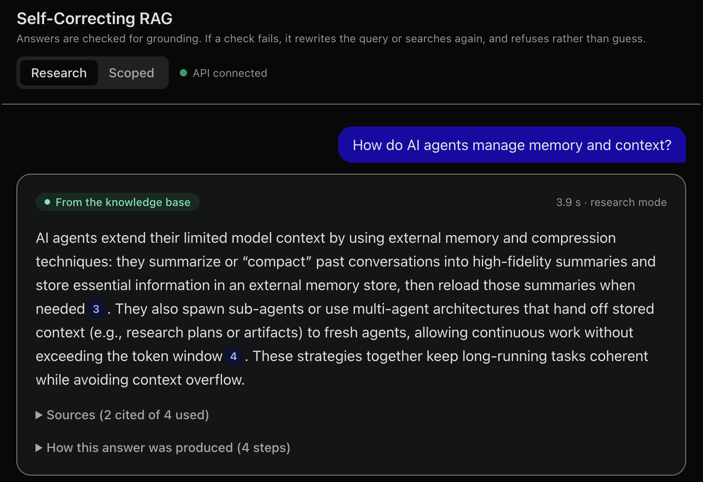
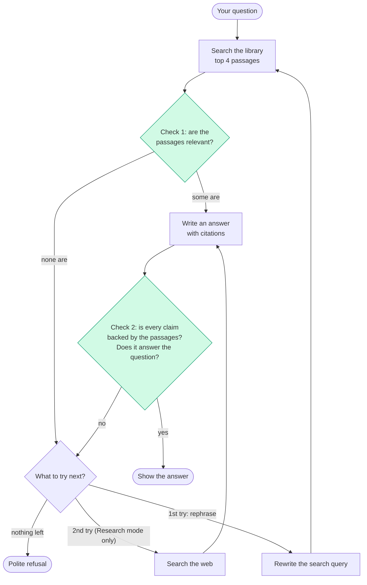
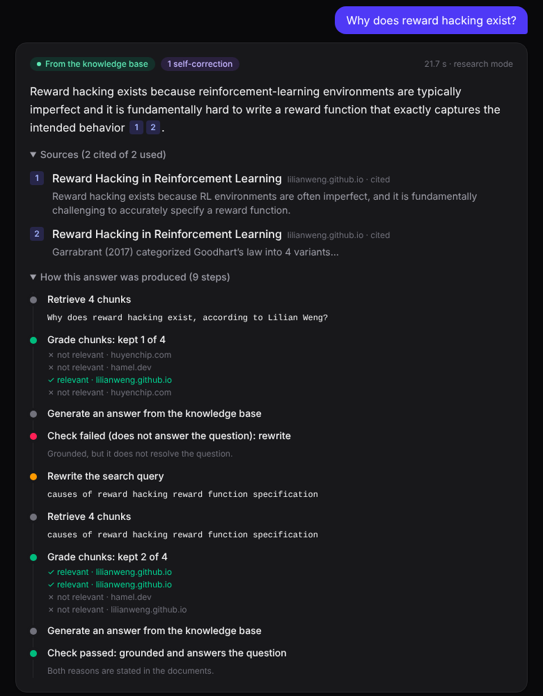
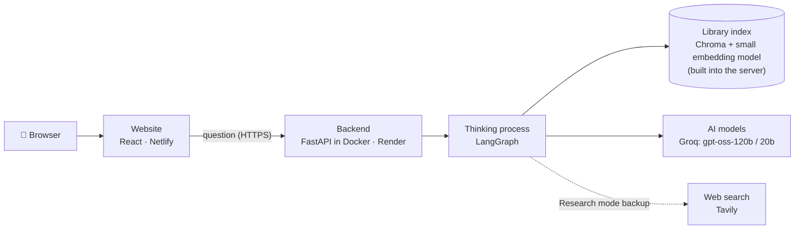

# Self-Correcting RAG

**An AI assistant that checks its own answers before showing them, and says "I don't know" instead of making things up.**

🔗 **Live demo:** [self-correcting-rag.netlify.app](https://self-correcting-rag.netlify.app)
🔗 **API (interactive docs):** [self-correcting-rag-ijk6.onrender.com/docs](https://self-correcting-rag-ijk6.onrender.com/docs)

> The demo runs on free hosting. If nobody has used it for 15 minutes, the server goes to sleep and the
> **first question takes about a minute** while it wakes up. After that, answers take a few seconds.
> To protect the free AI quota, each visitor can ask **5 questions per hour**.



---

## What is this, in plain words?

Imagine a research assistant with a small library of 12 expert articles about AI. You ask a question,
and the assistant:

1. **finds** the most relevant pages in its library,
2. **throws away** the pages that turn out not to be about your question,
3. **writes an answer** using only those pages, with numbered references like `[2]`,
4. **checks its own work**: *"Is every sentence actually backed by the pages? Does it really answer the question?"*
5. If the check fails, it **tries again differently**: it rephrases the search, or (if allowed) looks on the web.
6. If it still can't find a reliable answer, it **politely says so** instead of guessing.

That last part is the point of the project. Most chatbots answer confidently even when they don't know.
This one is built to **notice when it doesn't know**.

### Why this matters: a real example from this project

Early on, before the checks existed, I asked it *"Who won the 2022 FIFA World Cup?"*. Football isn't in
its library at all, yet it answered *"Argentina"* from the AI model's own memory. The answer happened to
be right, but it **wasn't based on any source**, so there was no way to verify it. With the same behaviour,
a company chatbot would just as confidently invent a refund policy that doesn't exist.

With the checks, the same question now either gets a **sourced answer from the web** (with links you can
open) or an **honest refusal**, depending on the mode.

### Two modes

| Mode | What it uses | Good for |
|---|---|---|
| **Research** | the library first; the **web only as a backup** | a general assistant |
| **Scoped** | **only the library**; never the web | a company assistant that must stay on its own documents |

---

## How it works

### The thinking process (the "graph")

Every question goes through these steps. The green boxes are where the system **checks itself**.



- It can retry **at most twice** (one rephrase, one web search), so it can never get stuck in a loop.
- The checks are done by AI "graders": separate, narrow questions to an AI model, like *"Is this passage
  relevant? yes/no"*. This technique is called **LLM-as-a-judge**.
- The app shows the whole process, so you can see the self-correction for yourself:

<p align="center">
  
</p>

*The "How this answer was produced" panel: the first answer fails its check, the system rewrites the search,
and the second answer passes. (Screenshot from the UI with sample data.)*

### The system: how the pieces connect



| Piece | What it does | Technology |
|---|---|---|
| Website | the chat page you see | React, TypeScript, Tailwind CSS, Vite; hosted on **Netlify** |
| Backend | receives questions, runs the thinking process, returns the answer and its steps | **FastAPI** (Python) in a **Docker** container on **Render** |
| Thinking process | the steps and checks in the diagram above | **LangGraph** |
| Library index | the 12 articles, split into ~550 passages and turned into "meaning vectors" for search | **Chroma**, embeddings by **fastembed** (`bge-small-en-v1.5`) |
| AI models | write answers and act as the graders | **Groq** (`gpt-oss-120b` for writing and checking, `gpt-oss-20b` for quick relevance checks) |
| Web search | the backup source in Research mode | **Tavily** |

**What's in the library:** 12 articles (2024–2025) on AI agents, context engineering, multi-agent systems,
tools and MCP, RAG, reasoning models, reward hacking, hallucinations and LLM evaluation, from Anthropic's
engineering blog, Lilian Weng, Hamel Husain and Chip Huyen. The articles are downloaded and indexed when
the server is built; their text is not stored in this repository.

---

## Does it actually work? (Evaluation)

I didn't want to judge it by "the answers look good", so I built a test.

**The test:** 22 questions in 6 groups, each with a reference answer written from the articles:

| Group | Example | The right behaviour |
|---|---|---|
| In the library (12) | "By how much does Contextual Retrieval reduce failed retrievals?" | answer from the library |
| Casually worded (3) | "is it fine to rate AI answers from 1 to 5?" | answer from the library |
| Needs two articles (1) | "How do subagents help with a limited context window?" | answer from the library |
| Off-topic (3) | "Who won the 2022 FIFA World Cup?" | Research: answer from the web · Scoped: refuse |
| Recent news (1) | "What AI models were released this week?" | Research: web · Scoped: refuse |
| Made up (2) | "What is the Kowalski-Reyes benchmark?" (doesn't exist) | **refuse**, always |

**The comparison:** the same questions went through three versions:
- **Naive RAG:** search once, answer once, no checks (the usual basic approach)
- **Self-correcting, Research mode**
- **Self-correcting, Scoped mode**

All three use the same library, the same answer instructions and the same AI model, so any difference
comes from the self-correction alone. A **different AI model** (`qwen3.8-27b`) acted as an independent
judge, so the system wasn't grading its own work.

### Results

| | Naive | Research | Scoped |
|---|---|---|---|
| Did the right thing (answer / web / refuse) | 95% | 95% | 95% |
| Found the right article | 100% | 100% | 100% |
| **Cited the right article** | 75% | **88%** | **88%** |
| **Included the key facts** | 59% | **75%** | 72% |
| Correct, per the judge | 93% | 89% | 93% |
| Complete, per the judge | 60% | 63% | 47% |
| AI calls per question | **1** | 8.6 | 8.1 |
| Time per answer | **7 s** | 18 s | 20 s |

### What the results mean

- **Self-correction makes answers more trustworthy, not "smarter".** It cited the right source **13 points
  more often** and included **13–16 points more of the key facts**. On plain correctness, the simple version
  was just as good.
- **Good instructions do a lot of the work.** Even the simple version refused every made-up question,
  because the AI is told to answer *only* from the provided passages and to say a fixed refusal sentence
  otherwise. The self-correcting version adds web backup, better citations and a second check, **at about
  8× the AI calls and 2.5–3× the time**. Whether that's worth it depends on the use case.
- **Answers are short on purpose** (at most three sentences), which is why "complete" scores are modest.
  That's a trade-off between short answers and complete ones, and easy to change.
- **The web backup can make things worse.** For one question, the library's definition was correct, but
  after a failed check the web provided a *different* definition. A web fallback is not automatically safer.

### What I changed because of the tests

The tests found real problems that hand-testing missed:

1. **I removed a "router" step.** Originally, an AI first decided "library or web?". The tests showed it
   sometimes sent library questions to the web, where one got an answer that **contradicted** the
   library, and it once crashed on malformed output. Since nothing later could fix a wrong route, it went.
   The system now **always checks the library first**. Correct behaviour in Research mode went from
   **82% to 95%**.
2. **Some "failures" were bugs in my scoring, not in the AI.** One model writes citations as `【1】`
   instead of `[1]`, and numbers as `98.7 %`. My checker missed those, which made citation accuracy look
   like 0–40% when it was really 100%. Lesson: **check the measuring tool before blaming the model.**
3. **The judge is only as good as its reference answers.** It marked 4 correct answers as wrong because
   *my* reference answers were incomplete. After fixing them, the simple version's correctness went from
   77% to 93%. So I **spot-checked the judge by hand** before trusting its numbers.

### Honest caveats

- 22 questions is a small test set; treat the numbers as indicative, not precise.
- The tests ran with a different embedding model (`nomic-embed-text`, locally) than the live demo
  (`bge-small-en-v1.5`, chosen because it fits on free hosting), so the live demo may behave slightly differently.
- The judge is still strict about extra details that are true but missing from my short reference answers,
  so the "correct" numbers are a lower bound.

---

## Run it yourself

**You need:** Python 3.14, Node.js 22, free API keys for [Groq](https://console.groq.com) and
[Tavily](https://tavily.com). Optionally [Ollama](https://ollama.com) (with `nomic-embed-text`) for fully local embeddings.

### 1. Backend

```bash
git clone https://github.com/haidersjaf77/self-correcting-rag.git
cd self-correcting-rag
python3.14 -m venv .venv && source .venv/bin/activate
pip install -r requirements.txt
```

Create a `.env` file in the project folder:

```
GROQ_API_KEY=gsk_...
TAVILY_API_KEY=tvly-...
LLM_PROVIDER=groq
LLM_MODEL=openai/gpt-oss-120b
GRADER_MODEL=openai/gpt-oss-20b
EMBED_PROVIDER=fastembed
CHROMA_DIR=./chroma_db_fastembed
```

(`EMBED_PROVIDER=ollama` uses Ollama's `nomic-embed-text` instead, if you have Ollama running.)

Build the library index (downloads the 12 articles; takes a few minutes), then start the API:

```bash
python -m src.ingest
uvicorn src.api:app --port 8000          # interactive docs at http://localhost:8000/docs
```

Or ask a question from the terminal:

```bash
python -m src.graph "How do AI agents manage memory and context?"
python -m src.graph "Who won the 2022 FIFA World Cup?" --scoped
```

### 2. Website

```bash
cd frontend
npm install
npm run dev                              # http://localhost:5173
```

To work on the website without the backend, use built-in sample answers: `VITE_USE_MOCK=true npm run dev`.

### 3. Docker

```bash
docker compose up --build                # builds the index into the image; API on http://localhost:8000
```

### 4. Evaluation

```bash
python -m evals.run_eval --out evals/results/my-run.jsonl          # all 3 versions, all questions
python -m evals.judge evals/results/my-run.jsonl                    # AI judge
python -m evals.report evals/results/my-run.judged.jsonl            # results table
```

Runs can be resumed after a crash or a rate limit: just run the same command again.

---

## Project structure

```
src/
  config.py       all settings, read from environment variables
  ingest.py       downloads the articles, splits them, builds the index
  embeddings.py   picks the embedding model (Ollama locally, fastembed when deployed)
  components.py   the AI model, prompts, graders, query rewriter, web search
  graph.py        the thinking process (LangGraph) + a command-line entry point
  naive.py        the simple baseline used in the evaluation
  api.py          the web API (FastAPI): /ask, /health, rate limiting, CORS
evals/
  questions.jsonl the 22 test questions with reference answers
  run_eval.py     runs the questions through each version
  judge.py        AI-as-a-judge scoring
  report.py       turns results into the tables above
frontend/         the React website
notebooks/        where the project started: step-by-step experiments
Dockerfile, docker-compose.yml, render.yaml, netlify.toml   deployment
```

## Settings

| Variable | Default | What it does |
|---|---|---|
| `LLM_PROVIDER` | `ollama` | `groq` (cloud) or `ollama` (local) |
| `LLM_MODEL` / `GRADER_MODEL` | `qwen3:8b` | main model / quick-check model |
| `EMBED_PROVIDER` | `ollama` | `fastembed` (in-process) or `ollama` |
| `CHROMA_DIR` | `./chroma_db` | where the index lives |
| `ALLOW_WEB_FALLBACK` | `true` | default mode for the command line |
| `RATE_LIMIT_PER_HOUR` | `0` (off) | questions per visitor per hour (`5` on the live demo) |
| `ALLOWED_ORIGINS` | `http://localhost:5173` | websites allowed to call the API (CORS) |
| `JUDGE_MODEL` | `qwen/qwen3.8-27b` | the evaluation judge |

## Limitations and next steps

- **Live step-by-step display:** the website shows the steps after the answer arrives; next is streaming
  them while the system is still working.
- **Speed:** each answer makes about 8 AI calls. Smaller grading models or merging checks would cut that.
- **Bigger, harder test set**, including questions written by other people, and a re-run of the evaluation
  on the deployed configuration.
- **Free-tier limits:** the demo depends on free quotas (Groq, Tavily, Render), so it can be slow to
  wake and may pause when a daily quota runs out.

## Credits

Built with [LangGraph](https://www.langchain.com/langgraph), [LangChain](https://www.langchain.com),
[Chroma](https://www.trychroma.com), [fastembed](https://github.com/qdrant/fastembed),
[FastAPI](https://fastapi.tiangolo.com), [Groq](https://groq.com) and [Tavily](https://tavily.com).
Inspired by the Elastic tutorial
[*Local RAG agent with LangGraph*](https://www.elastic.co/search-labs/blog/local-rag-agent-elasticsearch-langgraph-llama3).
The knowledge base articles belong to their authors: Anthropic, Lilian Weng, Hamel Husain and Chip Huyen.
